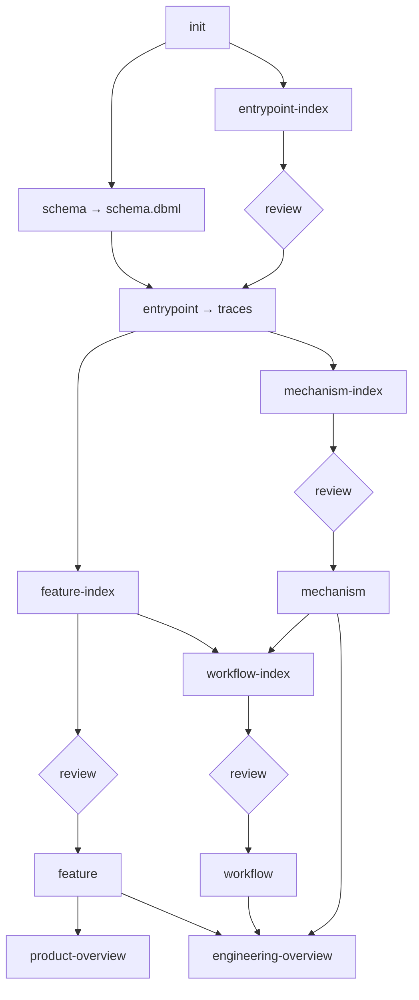

# Documentation skill

Turn application source code into product and engineering documentation, one reviewable step at a time, or run the whole pipeline at once.

**The core idea: discover → edit the index → generate documents → feed those documents into the next step.** Indexes are editable plans. You set the scope and boundaries before the agent writes detailed docs.

## Install and invoke

Replace `OWNER/REPO` with this repository's GitHub name:

```bash
npx skills add OWNER/REPO --skill documentation
```

Add `-g` to install across all projects, or `--agent '*'` to target every supported agent. Then, from your application project, ask your coding agent:

```text
documentation <command> [arguments]
```

These are agent requests, not terminal commands. (The `entrypoint` command is called `trace` inside [instructions/entrypoint.md](instructions/entrypoint.md).)

## Pipeline



Each `{review}` is an optional point to edit an index before its documents are generated. Workflow discovery needs the feature index and completed mechanism docs, but not feature docs. The engineering overview needs all three.

## Commands

| Command | What it does | Produces |
|---|---|---|
| `init` | Asks for the docs folder (default `docs`) and adds sync reminders to the project's agent instructions. | `codebase.yaml`, docs folder |
| `schema` | Captures tables, relationships, JSON shapes and database-enforced rules. | `schema.dbml` |
| `entrypoint-index` | Finds HTTP, GraphQL, RPC, message, scheduled and CLI entrypoints. | `entrypoint-index.json` |
| `entrypoint` | Traces each entrypoint through middleware, handlers, database work and side effects. Later stages use these traces as their evidence. | `entrypoints/<id>.md` |
| `feature-index` | Groups traced entrypoints into outcomes users can recognize. | `feature-index.json` |
| `feature` | Explains what actors can do, their journeys and the rules involved. Written for product owners. | `features/<id>.md` |
| `product-overview` | Combines the features into one standalone product explanation. | `overview.md` |
| `mechanism-index` | Finds deliberate implicit behavior such as custom middleware, context propagation, hooks or DB policies. | `mechanism-index.json` |
| `mechanism` | Explains each mechanism's contract, where it applies, its guarantees and its limits. | `mechanisms/<id>.md` |
| `workflow-index` | Finds coordinated processes and their state or consistency invariants. | `workflow-index.json` |
| `workflow` | Explains state transitions, ordering, transactions, concurrency and recovery. | `workflows/<id>.md` |
| `engineering-overview` | Combines architecture, data, workflows and mechanisms into one standalone guide. | `engineering.md` |
| `exec` | Runs the full pipeline in order without pausing for review. It keeps valid work and stops a stage when its prerequisites failed. | Everything |
| `sync` | Updates only the docs affected by current code changes and reports anything stale or blocked. | Updated artifacts |
| `explain <question>` | Answers an engineering question and saves the reusable explanation. | `mechanisms/topics/<id>.md` |

A **feature** is a product outcome, a **mechanism** is an implicit technical contract, and a **workflow** is coordinated execution and state. They don't map one-to-one.

Downstream writers build on existing docs and don't retrace code. **If evidence is wrong, fix the trace first**, then regenerate whatever depends on it.

## Indexes are your control surface

| Index | You control | Next command |
|---|---|---|
| `entrypoint-index.json` | Which invocations exist, plus their triggers and handlers | `entrypoint` |
| `feature-index.json` | Feature names, outcomes and entrypoint membership | `feature` |
| `mechanism-index.json` | Contracts, applicable entrypoints and tables | `mechanism` |
| `workflow-index.json` | Invariants and feature/entrypoint/table/mechanism links | `workflow` |

**Review loop:** run `*-index` → edit the JSON → set changed records to `"doc_status": "pending"` → run the writer → review the output before running dependent stages.

```json
{
  "id": "team-invitations",
  "name": "Team invitations",
  "outcome": "Workspace administrators invite members to join their workspace",
  "entrypoints": ["http-post-api-workspaces-id-invitations"],
  "doc_status": "pending"
}
```

Then run `documentation feature team-invitations`.

**Rules for safe edits:**
- `done` means the doc was generated and verified. Never set it by hand to skip ahead.
- Keep IDs stable, because other indexes and file paths refer to them. Keep the JSON valid (the [templates](template/) are `.jsonc` with comments).
- Record exclusions and unknowns instead of dropping them.
- **Don't rerun discovery just to regenerate docs**, because it can overwrite your edits. Run the writer directly.
- Editing or removing records doesn't regenerate or clean up downstream docs. Refresh them yourself or use `sync`.
- Mechanism entrypoint patterns support a trailing `*` as an ID-prefix match, not a route wildcard.

## Selecting what to generate

The `entrypoint`, `feature`, `mechanism` and `workflow` writers take the same arguments:

| Form | Effect |
|---|---|
| `documentation feature` | Pending records only |
| `documentation feature <id> <id>` | The selected IDs, whatever their status |
| `--limit 5` | A small batch |
| `--retrace` | Regenerate everything |
| `--yes` | Replace existing docs without asking |

**Product docs only:** `init` → `schema` → `entrypoint-index` → `entrypoint` → `feature-index` → `feature` → `product-overview`, reviewing each index before its writer runs.

## Configuration and output

`codebase.yaml` lives in the project root and sets the docs root and each artifact's path, all relative to the project ([template](template/codebase.yaml)). Legacy configs that only set `index` and `docs` still work.

```text
docs/
├── schema.dbml
├── {entrypoint,feature,mechanism,workflow}-index.json
├── entrypoints/  features/  mechanisms/  mechanisms/topics/  workflows/
├── overview.md
└── engineering.md
```

The commands never modify application code.
